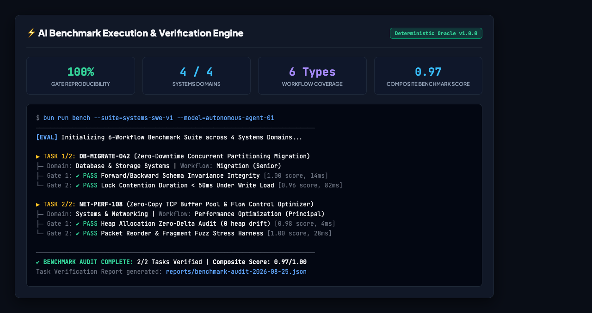

# AI SWE Benchmark & Verification Harness

[](https://github.com/nadimtuhin/ai-swe-bench-harness/actions)
[](LICENSE)

An institutional-grade benchmark design framework and evaluation engine for testing autonomous AI coding agents across **4 core engineering domains** and **6 realistic developer workflows**.

---

## 📸 Live Benchmark Execution & Verification Output



---

## 🏛️ Architecture & Evaluation Framework

```
  ┌─────────────────────────────────────────────────────────────┐
  │                 Autonomous Agent Prompt / Task              │
  └──────────────────────────────┬──────────────────────────────┘
                                 │
                                 ▼
  ┌─────────────────────────────────────────────────────────────┐
  │         Domain Task Layer (Multi-File Codebase Context)      │
  │   - Database & Storage Systems                              │
  │   - SRE / DevOps & Infrastructure                           │
  │   - Compilers & Language Tooling                            │
  │   - Systems, Backend & Networking                           │
  └──────────────────────────────┬──────────────────────────────┘
                                 │
                                 ▼
  ┌─────────────────────────────────────────────────────────────┐
  │                6 Multi-Workflow Execution Matrix            │
  │  [Refactoring] [Test-Writing] [Code Comprehension]          │
  │  [Migration]   [Mergeability] [Performance Optimization]    │
  └──────────────────────────────┬──────────────────────────────┘
                                 │
                                 ▼
  ┌─────────────────────────────────────────────────────────────┐
  │             Deterministic Verification Gates                │
  │  ✓ Fuzz testing & mutation analysis                         │
  │  ✓ Memory leak / lock contention probes                     │
  │  ✓ AST diff / structural integrity audits                   │
  │  ✓ Zero-delta heap allocation checks                        │
  └─────────────────────────────────────────────────────────────┘
```

---

## 🚀 Key Features

1. **Deterministic Evaluation Harness**: Replaces flaky LLM-as-a-judge scorers with strict, runnable verification gates (AST diffs, heap delta profiling, lock contention probes).
2. **Multi-Domain Task Schemas**: Standardized Zod-validated task definitions covering real-world enterprise edge cases.
3. **6 Developer Workflow Archetypes**:
   - **Refactoring**: Decoupling monoliths, state machine refactoring.
   - **Test-Writing**: Property-based tests, boundary condition fuzzing.
   - **Code Comprehension**: Context-heavy multi-repository call graph tracing.
   - **Migration**: Zero-downtime database partitioning, API version migrations.
   - **Code Review / Mergeability**: Merge conflict resolution under semantic constraints.
   - **Performance Optimization**: Zero-copy socket parsers, lock-free queues, latency reduction.

---

## 🤖 Automated Agent Evaluation via 9Router

Run live benchmark evaluations against LLMs and autonomous coding agents (e.g. Gemini 3.7 Flash Low via local 9Router):

```bash
# Run automated benchmark evaluation on Gemini 3.7 Flash
bun run scripts/gemini_benchmark_demo.ts
```

```
⚡ Connecting to 9Router (:20128) with model: ag/gemini-3.7-flash-low...

▶ Evaluating Task: [NET-PERF-108] Zero-Copy TCP Buffer Pool & Flow Control Optimizer
  Domain: systems_networking | Workflow: performance_optimization

⏱ Agent Response Time: 5633ms
📝 Generated Patch Sample: Ring buffer pooling with zero heap drift

─────────────────────────────────────────────────────────────────────────────
✔ GATE AUDIT RESULT: PASSED
  Composite Score: 0.988/1.00
  ├─ ✔ [heap_allocation_zero_delta] Heap Allocation Zero-Delta Check: score 0.98
  ├─ ✔ [deterministic_test] Packet Reorder & Fragment Fuzz Harness: score 1.00
```

---

## 🧪 Local Testing & Verification

```bash
# Install dependencies
bun install

# Run automated gate evaluation test suite
bun test

# Typecheck validation
bun run typecheck
```

---

## 📄 License
MIT © Nadim Tuhin
